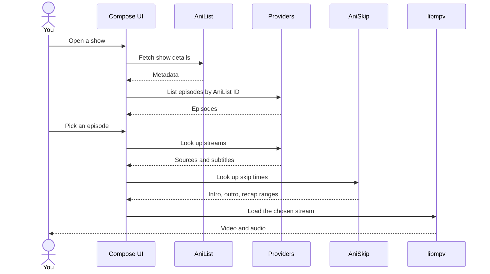

# AniLife for desktop

[](https://github.com/anilifecommunity/kotlindesktop/actions/workflows/build.yml)
[](https://kotlinlang.org)
[](#install)

[](https://github.com/anilifecommunity/kotlindesktop/releases/latest)
[](https://github.com/anilifecommunity/kotlindesktop/actions/workflows/build.yml?query=branch%3Amain+is%3Asuccess)

A Windows desktop client for watching anime, written in Kotlin with Compose Multiplatform. It is a port of AniLife to the JVM. Show data comes from AniList, and playback goes through libmpv.

## What it does

- Browses and searches AniList, with a weekly airing schedule and a library of what you are watching.
- Finds streams through the Miruro catalog API and through seven bundled WebAssembly provider modules: animeheaven, animeonsen, animepahe, anipm, anizone, megaplay and rift. The modules run in wasmtime.
- Plays video with libmpv, with subtitle tracks, subtitle delay, speed control and keyboard shortcuts.
- Skips intros, outros and recaps using AniSkip data when it exists for an episode.
- Syncs your list with MyAnimeList.
- Shows what you are watching in Discord, if the Discord desktop client is running.
- Queues episode downloads, plays local files, and posts a notification when a new episode of a show in your library has aired.
- Has a command palette for jumping between screens.

## Install

Builds are on the [Releases](../../releases) page. There are two kinds, each as an `.msi` and an `.exe`:

- The base build is a normal installer. It adds a Start Menu entry and a desktop shortcut, and you remove it from Windows Settings.
- The portable build installs nothing system-wide. The portable `.msi` installs per user, with no shortcuts, into a folder you pick. The portable `.exe` is one file that unpacks to a temporary folder and starts the app.

The latest release is the stable build. The latest beta is the newest successful run of the Build workflow on `main`. Open the run and scroll to Artifacts. Beta builds are untested, and GitHub asks you to sign in before it lets you download from Actions. The files download as plain files, not zips.

## First launch

AniLife needs libmpv. If it cannot find one, it downloads the latest 64-bit LGPL build of `libmpv-2.dll` from the mpv releases into `%USERPROFILE%\.anilife`. To use your own copy, start the app with `-DAniLife.mpv.library=<path to libmpv>`. Settings, then About, shows which library is loaded.

## MyAnimeList sign-in

Sign-in needs a MAL API client ID. Copy `.env.example` to `.env` in the directory you launch the app from and set `MAL_CLIENT_ID`. The `MAL_CLIENT_ID` environment variable works too. Without it, the rest of the app is unaffected and the sign-in page says the ID is missing.

## Build from source

You need JDK 21. Gradle downloads everything else.

```
./gradlew :app:run                 # run the app
./gradlew test                     # run the tests
./gradlew :app:packageMsi          # build the MSI installer
./gradlew :app:packageExe          # build the EXE installer
```

Installers must be built on Windows. Tests that need libmpv skip themselves when it is not installed.

CI lives in `.github/workflows/build.yml`. It builds the four Windows files on every push and attaches them to a GitHub release when you push a tag like `v1.2.0`. The tag becomes the package version, so it has to be three numbers.

## Keyboard shortcuts in the player

| Key | Action |
| --- | --- |
| Space, K | Play or pause |
| Left, Right | Seek 5 seconds |
| J, L | Seek 10 seconds |
| Up, Down | Volume |
| M | Mute |
| F | Fullscreen |
| Z, X | Subtitle delay, earlier or later |
| [ and ] | Playback speed |

## Layout

| Module | Contents |
| --- | --- |
| `core` | Data models and the AniList and AniSkip clients |
| `mpv` | A JNA binding to the libmpv client and render API |
| `app` | The Compose UI, providers, downloads, MAL sync and Discord presence |

The bundled provider modules are in `app/src/main/resources/providers`. They all implement one WIT interface and run as WASI Preview 2 components.

## How playback works

AniList supplies show metadata. Episodes and streams come from the providers, keyed by the AniList ID, and AniSkip supplies the intro, outro and recap ranges.



## Limitations

Windows x86-64 only for now. The wasmtime native library is pinned to its Windows build, and the libmpv download fetches a Windows DLL. Linux support would mean changing both. macOS is untested.

The app does not host any video. Streams come from third-party sites, and which ones work changes over time.
